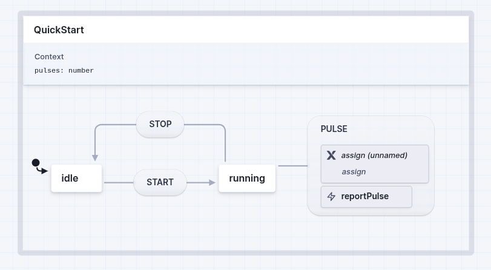

# XFSM

XFSM is an optional native hierarchical state-machine engine for Espruino. It
lets an application define a statechart in JavaScript and run it with a compact
native C engine.

XFSM uses familiar XState-style machine definitions, actors, events, actions,
guards, context, and snapshots. The supported feature set is **Profile 2**. It
is designed for embedded control applications that need predictable behaviour
and controlled memory use.

This README accompanies the deployable XFSM library source. The source is
maintained under `xfsm/` in the standalone
[Espruino-XFSM repository](https://github.com/SimonGAndrews/Espruino-XFSM) and
exported unchanged to `libs/xfsm/` in an Espruino checkout. Specifications,
build guidance, qualification evidence, and reusable examples remain in the
standalone repository.

## Quick Start



This machine has `idle` and `running` states. `START` moves to `running`,
`STOP` returns to `idle`, and each `PULSE` increments a counter without changing
state. The `reportPulse` action runs after the counter is updated.

With XFSM included in the firmware, define a machine, create an actor, and
start it before sending events:

```javascript
var XFSM = require("XFSM");
var assign = XFSM.assign;

var machine = XFSM.createMachine({
  id: "QuickStart",
  context: { pulses: 0 },
  initial: "idle",
  states: {
    idle: {
      on: {
        START: "running"
      }
    },
    running: {
      on: {
        PULSE: {
          actions: [
            assign({
              pulses: function (context, event) {
                return context.pulses + event.amount;
              }
            }),
            "reportPulse"
          ]
        },
        STOP: "idle"
      }
    }
  }
}, {
  actions: {
    reportPulse: function (context, event) {
      print("pulse", event.amount, "total", context.pulses);
    }
  }
});

var actor = XFSM.createActor(machine);

var subscription = actor.subscribe(function (snapshot) {
  print(snapshot.status, JSON.stringify(snapshot.value),
        JSON.stringify(snapshot.context));
});

actor.start();
actor.send("START");
actor.send({ type: "PULSE", amount: 2 });

var snapshot = actor.getSnapshot();
print(snapshot.matches("running")); // true

actor.send("STOP");
actor.stop();
subscription.unsubscribe();
```

The machine definition describes its states and transitions. Its `context`
holds application data. `assign()` creates an action that updates that data.
Named actions and guards are supplied in the second argument to
`createMachine()`.

`createMachine()` checks and compiles the definition once. Each
`createActor()` call creates an independent running instance. `start()`,
`send()`, and `stop()` are synchronous. `getSnapshot()` returns the actor's
stable state and context. Subscribers are called only after an operation
completes successfully.

## Main API

An application loads XFSM as a built-in Espruino module:

```javascript
var XFSM = require("XFSM");
```

### Create a machine

`XFSM.createMachine(definition, implementations)` checks the JavaScript machine
definition and compiles it into a compact native representation. The optional
second argument supplies named actions and guards used by the definition.

A machine can be shared by several actors. The definition is compiled once and
is not changed while those actors run.

### Update context

`XFSM.assign(...)` creates an action that updates the actor's context. Actions
and assignments run in their declared order. A later action in the same
operation sees context updates made by an earlier assignment.

### Run an actor

`XFSM.createActor(machine)` creates an actor with its own state, context,
lifecycle, snapshots, and subscriptions. Use:

- `start()` to enter the initial state;
- `send(event)` to process an event;
- `getSnapshot()` to read the stable state and context;
- `subscribe(listener)` to observe completed operations; and
- `stop()` to stop the actor.

Several actors can share one compiled machine without sharing their current
state or context. A failed action, guard, context factory, or runtime allocation
puts the affected actor into a terminal error state.

## Supported Statecharts

Profile 2 handles one active state branch at a time. It supports:

- nested states and initial child states;
- string and object events;
- guarded transitions and ordered fallback selection;
- entry, exit, and transition actions;
- ordered context assignments;
- relative and ID-based transition targets;
- targetless transitions and explicit state re-entry;
- wildcard event handlers;
- final states and completion transitions;
- stable snapshots and subscriptions; and
- one shallow or deep history node for each compound state.

Selected aliases are accepted to help migrate older XState machine
definitions. Parallel states, delayed transitions, eventless transitions,
invoked services, and spawned actors are not included.

The [Profile 2
specification](https://github.com/SimonGAndrews/Espruino-XFSM/blob/main/docs/specification-profile-2.md)
defines the supported syntax, limits, error behaviour, and compatibility
differences. Profile 1 remains documented as the smaller baseline without
history states.

## Add XFSM to an Espruino Build

To include XFSM in a board build, add `XFSM` to the board's
`info.build.libraries` list. Espruino then sets `USE_XFSM=1` and includes the
wrapper and engine sources.

Development builds can select the library directly:

```bash
make clean
make USE_XFSM=1
```

XFSM is not enabled by default in any standard Espruino board definition. The
[build guide](https://github.com/SimonGAndrews/Espruino-XFSM/blob/main/docs/building.md)
records the verified Linux and microcontroller build commands. Maintainers
copy committed library source into Espruino using the
[integration workflow](https://github.com/SimonGAndrews/Espruino-XFSM/blob/main/docs/espruino-integration.md).

## How XFSM Works

Profile 2 uses the private, frozen Native Format Version 2.

`createMachine()` indexes the state hierarchy, resolves transition targets,
and collects the JavaScript functions and values that the machine must keep.
The compiler first counts the native records and strings, then writes them into
one exact-sized data block. XFSM returns the machine only after checking the
completed block. A failed compilation releases its temporary values and does
not return a partial machine.

Calls to `start()`, `send()`, and `stop()` use a native execution coordinator.
It selects transitions by state index, follows parent links where needed, and
runs actions and completion transitions in order. XFSM publishes the new state,
context, and snapshot only after the operation reaches a stable state.

The main source files have these roles:

- `jswrap_xfsm.c` defines the Espruino module and forwards calls to the engine.
- `xfsm_compile.c` checks and compiles JavaScript machine definitions.
- `xfsm_native.h` defines Native Format Version 2, while `xfsm_native.c` checks
  the compiled offsets, ranges, indexes, byte order, and padding.
- `xfsm_runtime.c` manages actors, transitions, actions, context, snapshots,
  and subscriptions.
- `xfsm_measure.c` and `xfsm_test.c` provide private measurement and
  fault-injection support for special test builds.

The [memory ownership
diagram](https://github.com/SimonGAndrews/Espruino-XFSM/blob/main/docs/memory-ownership.md)
and [memory lifetime
diagram](https://github.com/SimonGAndrews/Espruino-XFSM/blob/main/docs/memory-lifetime.md)
show how the JavaScript and native data are held during compilation and actor
operation.

## Test XFSM

Run tests from the root of an Espruino source repository after copying XFSM to
`libs/xfsm/`. A basic Linux check is:

```bash
make clean
make USE_XFSM=1
bin/espruino --test libs/xfsm/tests/test_shell.js
```

The complete [build and test
guide](https://github.com/SimonGAndrews/Espruino-XFSM/blob/main/docs/building.md)
lists the verified commands and target profiles. The test material under
`libs/xfsm/tests/` includes:

- JavaScript suites for compilation, runtime behaviour, transitions, context,
  lifecycle, errors, resource limits, and shallow and deep history;
- streamed conformance traces compared with reviewed baselines, including
  pinned XState reference traces;
- deterministic allocation-failure tests enabled with `XFC_TEST=1`;
- resource measurements enabled with `XFC_MEASURE=1`; and
- physical-device tests for save and restore, GPIO, timers, memory cleanup,
  event scheduling, and wireless-service coexistence.

The native-format sanitizer suite checks the compiled C representation without
using the Espruino interpreter:

```bash
make -C libs/xfsm/tests/native clean test
```

The static audit checks source rules that are difficult to exercise with a
JavaScript scenario:

```bash
python3 libs/xfsm/tests/audit_static_contract.py
```

Physical tests use the procedures in the
[device-testing guide](https://github.com/SimonGAndrews/Espruino-XFSM/blob/main/docs/esp32-device-testing.md).
Completed coverage and remaining target work are recorded in the
[test inventory](https://github.com/SimonGAndrews/Espruino-XFSM/blob/main/tests/test-inventory.md)
and [implementation
status](https://github.com/SimonGAndrews/Espruino-XFSM/blob/main/docs/implementation-status.md).

## Native Stack Requirement

Before `start()`, `send()`, or `stop()` begins, XFSM checks that enough native C
stack remains for the execution coordinator. Normal builds require at least
1024 bytes in addition to Espruino's general 512-byte C-stack safety allowance.
If the space is unavailable, the operation fails before changing the actor.

A measured target can override the private build setting with
`XFC_STACK_RESERVE=<bytes>`. This is not a JavaScript option and should be
changed only after measuring the target's maximum stack use.

## Licence

XFSM is licensed under the Mozilla Public License 2.0. See the standalone
project's [licensing
guide](https://github.com/SimonGAndrews/Espruino-XFSM/blob/main/LICENSING.md)
and [third-party
notices](https://github.com/SimonGAndrews/Espruino-XFSM/blob/main/THIRD_PARTY_NOTICES.md).
